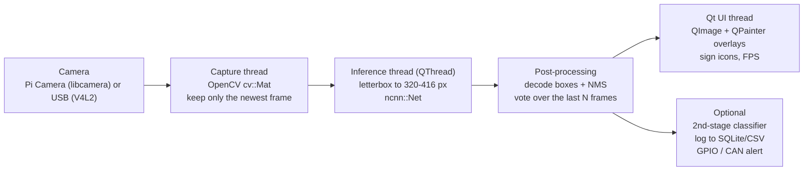

# Robotics R&D Notes

Research notes for three robot projects, plus a motor-reference list.

1. [Road-sign detection on Raspberry Pi 4B with Qt](#1-road-sign-detection-on-raspberry-pi-4b-with-qt)
2. [AI weeding robot (detect and remove weeds)](#2-ai-weeding-robot-detect-and-remove-weeds)
3. [Warehouse robot (push/pop cargo towers)](#3-warehouse-robot-pushpop-cargo-towers)
4. [Motor handbooks](#4-motor-handbooks)
5. [Links and downloads](#5-links-and-downloads)
6. [Sources and verification status](#6-sources-and-verification-status)

> **Last updated: 2026-10-19.** GitHub facts (stars, licenses, last activity, README contents, benchmark tables) were checked live through the GitHub API on that date. Company, product, customer and price information was compiled with an AI assistant (Claude) from its knowledge as of mid-2026 and was **not** re-checked online. Confirm with the manufacturer before buying, quoting or citing anything. Details in [section 6](#6-sources-and-verification-status).

---

## 1. Road-sign detection on Raspberry Pi 4B with Qt

### 1.1 What limits the choice

- The Pi 4B has a 4-core Cortex-A72 CPU and **no NPU**. Only *nano*-size detectors run in real time, and the inference runtime matters as much as the model.
- Ultralytics' own Raspberry Pi guide states that **NCNN** gives the best inference performance on Raspberry Pi of all its export formats. Qengineering's well-known C++ Pi examples also use NCNN.
- Traffic signs are small and often far away, so **input resolution vs. frame rate** is the central trade-off.

### 1.2 What is the best model?

Measured on a Raspberry Pi 4 (from Qengineering's benchmark tables: Pi 4 overclocked to 1950 MHz, 64-bit OS, ncnn, inference time only, COCO-pretrained weights):

| Model | Input (px) | COCO mAP | Pi 4 FPS | License |
|---|---|---|---|---|
| YoloFastestV2 | 352 | 24.1 | **18.8** | no license file in repo |
| NanoDet | 320 | 20.6 | 13.0 | Apache-2.0 |
| PP-PicoDet | 320 | 27.0 | 7.5 | Apache-2.0 |
| YOLOX-Nano | 416 | 25.8 | 7.0 | Apache-2.0 |
| NanoDet-Plus | 416 | 30.4 | 5.0 | Apache-2.0 |
| YOLOv8n | 640 | 37.3 | 3.1 | AGPL-3.0 |

Ultralytics' current model family is **YOLO26** (YOLO27 is announced as "coming soon" and is not released as of this date). Official figures: **YOLO26n = 40.9 COCO mAP, 2.4 M parameters, 5.5 GFLOPs**. On a **Raspberry Pi 5** its NCNN export runs at about **67 ms per image at 640 px**. Ultralytics publishes no Pi 4 figure. A Pi 5's CPU is roughly 2-3x faster than a Pi 4's, so expect very roughly 130-200 ms at 640 px on a Pi 4 (an estimate, measure it on your board) and train/run at **320-416 px** instead.

**Recommendation**

| Pick | Model | Why / when |
|---|---|---|
| **Best overall** | **YOLO26n**, fine-tuned on your country's signs at `imgsz=416` (also try 320), exported to NCNN, run with the ncnn C++ API inside Qt | Highest accuracy of the nano-size models listed here (40.9 COCO mAP vs. 37.3 for YOLOv8n) at only 5.5 GFLOPs. Its training recipe includes small-target-aware label assignment (STAL), which helps with small, distant signs. **License is AGPL-3.0**: if you ship a closed-source product you need an Ultralytics Enterprise license. |
| **Best permissive license** | **NanoDet-Plus**, **PP-PicoDet** or **YOLOX-Nano** (all Apache-2.0) with Qengineering's BSD-3 C++ code | Commercial, closed-source product. |
| **Fastest** | **YoloFastestV2** (18.8 FPS on Pi 4) | Speed matters more than accuracy. The repo has no license file, so get the author's permission before shipping it, or use **FastestDet** (BSD-3-Clause) by the same author. |
| **Many sign classes** | **Two-stage pipeline**: detector with a few super-classes (prohibitory / danger / mandatory / information) + a tiny CNN classifier on each crop, trained on GTSRB-style data | You can add new sign types by retraining only the small classifier. |

> **NCNN and NMS:** YOLO26 has an NMS-free end-to-end head (`nms=False`, output `(N, 300, 6)` = `[x1, y1, x2, y2, conf, class_id]`). It works with ONNX / TensorRT / OpenVINO exports, but per the Ultralytics docs **NCNN falls back to the standard head**. With NCNN you therefore decode `(N, nc+4, anchors)` and run NMS in C++ (for example `cv::dnn::NMSBoxes`). At `imgsz=416` there are only 3,549 candidate boxes, so NMS is cheap.

### 1.3 What is the best project on GitHub? (checked 2026-10-19)

No popular repository already does "Qt + Raspberry Pi 4 + traffic signs" end to end. A GitHub search for "traffic sign raspberry pi" returns only small projects (the top result has 19 stars). The best path is to **combine** the projects below.

| Repository | Stars | Lang | License | Last push | Why use it |
|---|---|---|---|---|---|
| [vietanhdev/open-adas](https://github.com/vietanhdev/open-adas) | 505 | C++ | MIT | 2023-10 | **Best Qt reference application.** A complete Qt5/C++ driver-assistance system with traffic-sign recognition, lane-departure, forward-collision and over-speed warnings. Built for Jetson Nano with TensorRT 5/6, so replace its TensorRT layer with ncnn for the Pi. |
| [Qengineering/YoloV8-ncnn-Raspberry-Pi-4](https://github.com/Qengineering/YoloV8-ncnn-Raspberry-Pi-4) | 128 | C++ | BSD-3-Clause | 2024-06 | **Best Pi inference starting point.** Plain C++ + ncnn + OpenCV on a bare Pi 4. Source of the benchmark table above. |
| [Qengineering/YoloFastestV2-ncnn-Raspberry-Pi-4](https://github.com/Qengineering/YoloFastestV2-ncnn-Raspberry-Pi-4) | 41 | C++ | BSD-3-Clause | 2024-06 | Fastest detector, same structure. |
| [Qengineering/NanoDet-ncnn-Raspberry-Pi-4](https://github.com/Qengineering/NanoDet-ncnn-Raspberry-Pi-4) | 24 | C++ | BSD-3-Clause | 2023-09 | Apache-licensed model example. |
| [Qengineering/TensorFlow_Lite_SSD_RPi_64-bits](https://github.com/Qengineering/TensorFlow_Lite_SSD_RPi_64-bits) | 43 | C++ | BSD-3-Clause | 2022-05 | TensorFlow Lite alternative (SSD, "24 FPS" per the repo). |
| [Ai-trainee/Traffic-Sign-Recognition-PyQt5-YOLOv5-GUI](https://github.com/Ai-trainee/Traffic-Sign-Recognition-PyQt5-YOLOv5-GUI) | 248 | Python | GPL-3.0 | 2024-05 | Ready-made **Qt (PyQt5) GUI** for road-sign recognition (YOLOv5, TT100K dataset, MySQL). Desktop-oriented and PyTorch is too slow on a Pi 4 as-is; use it as a UI reference. |
| [aarcosg/traffic-sign-detection](https://github.com/aarcosg/traffic-sign-detection) | 335 | Notebook | MIT | 2022-03 | Code from a paper that benchmarks detector architectures on traffic signs. Useful for understanding accuracy trade-offs. |
| [csust7zhangjm/CCTSDB](https://github.com/csust7zhangjm/CCTSDB) | 271 | n/a | n/a | 2024-07 | Chinese traffic-sign detection benchmark dataset. |

Frameworks and model repositories:

| Repository | Stars | License | Role |
|---|---|---|---|
| [ultralytics/ultralytics](https://github.com/ultralytics/ultralytics) | 62,623 | AGPL-3.0 | Train YOLO26 and export it to NCNN |
| [Tencent/ncnn](https://github.com/Tencent/ncnn) | 23,975 | BSD-3-Clause (see LICENSE) | Inference runtime optimized for ARM |
| [PaddlePaddle/PaddleDetection](https://github.com/PaddlePaddle/PaddleDetection) | 14,443 | Apache-2.0 | PP-PicoDet |
| [Megvii-BaseDetection/YOLOX](https://github.com/Megvii-BaseDetection/YOLOX) | 10,663 | Apache-2.0 | YOLOX-Nano |
| [RangiLyu/nanodet](https://github.com/RangiLyu/nanodet) | 6,276 | Apache-2.0 | NanoDet-Plus |
| [dog-qiuqiu/Yolo-FastestV2](https://github.com/dog-qiuqiu/Yolo-FastestV2) | 944 | none in repo | Yolo-FastestV2 |
| [dog-qiuqiu/FastestDet](https://github.com/dog-qiuqiu/FastestDet) | 863 | BSD-3-Clause | FastestDet |

### 1.4 Datasets

Road signs differ by country (Vienna Convention style in most of Europe, MUTCD in the USA, GB 5768 in China, national variants elsewhere). **Train on signs from the country where the system will drive.** Check each dataset's license; several are research / non-commercial only.

| Dataset | Region | Type | Notes |
|---|---|---|---|
| GTSRB | Germany | Classification, 43 classes, 50,000+ crops | Ideal for the 2nd-stage classifier |
| GTSDB | Germany | Detection, 900 images | Small; good for first tests |
| Mapillary Traffic Sign Dataset (MTSD) | Worldwide | Detection, 300+ classes, ~100k images | Best global coverage |
| TT100K (Tsinghua-Tencent 100K) | China | Detection, 2048x2048 street-view images | Many tiny, distant signs; papers usually use 45 common classes |
| [CCTSDB](https://github.com/csust7zhangjm/CCTSDB) | China | Detection, 3 super-classes | On GitHub |
| LISA | USA | Detection, 47 sign types | US-style (MUTCD) signs |
| DFG | Slovenia | Detection, 200 classes | European signs |
| Roboflow Universe | Many | Community datasets in YOLO format | Fast start; quality varies |

### 1.5 Suggested application architecture



- Keep capture, inference and UI in separate threads and pass results with Qt signals/slots. Never block the UI thread.
- Use a "latest frame wins" policy: drop old frames instead of queueing them, so latency stays low.
- Stabilize the output by requiring a sign to be detected in, say, 3 of the last 5 frames before showing it.

### 1.6 Quick start

```bash
# ---- Training PC (NVIDIA GPU recommended) ----
pip install -U ultralytics
# signs.yaml = YOLO-format dataset description (train/val paths + class names)
yolo detect train model=yolo26n.pt data=signs.yaml imgsz=416 epochs=150 batch=32
yolo export model=runs/detect/train/weights/best.pt format=ncnn imgsz=416
# -> best_ncnn_model/ (model.ncnn.param + model.ncnn.bin): copy it to the Pi

# ---- Raspberry Pi 4B (64-bit Raspberry Pi OS) ----
sudo apt update
sudo apt install -y build-essential cmake git qt6-base-dev libopencv-dev
git clone --depth=1 https://github.com/Tencent/ncnn.git
cd ncnn && mkdir build && cd build
cmake -DCMAKE_BUILD_TYPE=Release -DNCNN_VULKAN=OFF -DNCNN_BUILD_EXAMPLES=OFF ..
make -j4 && make install   # installs into ncnn/build/install
# In your Qt project's CMakeLists.txt:
#   set(ncnn_DIR /path/to/ncnn/build/install/lib/cmake/ncnn)
#   find_package(ncnn REQUIRED)
#   find_package(Qt6 REQUIRED COMPONENTS Widgets)
#   find_package(OpenCV REQUIRED)
```

Faster to prototype, slower at run time: a Python app with **PySide6** (official Qt for Python) + the Ultralytics package loading `best_ncnn_model` + Picamera2 for the camera.

### 1.7 Practical tips

- Use the **64-bit** Raspberry Pi OS and a **heatsink + fan**. A hot Pi 4 throttles its CPU and your FPS drops.
- On current Raspberry Pi OS the Pi Camera goes through **libcamera**. From C++ use libcamera directly, or a GStreamer pipeline with `libcamerasrc` into OpenCV. USB webcams work through V4L2.
- Small far-away signs: crop a region of interest (the roadside half of the image) and run the detector on that crop at full resolution, instead of shrinking the whole frame.
- int8 quantization in ncnn can add speed; always re-check accuracy afterwards.
- Accelerators: a **Coral USB Edge TPU** plugs into the Pi 4's USB 3 port (check driver support for your OS/Python version). Hailo AI kits need the PCIe connector of a **Pi 5**, so they do not fit a Pi 4.

---

## 2. AI weeding robot (detect and remove weeds)

### 2.1 Three ways robots remove weeds

| Method | How it works | Strengths | Weaknesses |
|---|---|---|---|
| **Laser (thermal)** | A camera finds the weed; a CO2 or diode laser heats its growing point | No chemicals, no soil disturbance, works right next to the crop | Very expensive, high power draw, eye-safety hazard, big weeds take longer |
| **Mechanical** | Vision-guided knives, hoes or fingers move in and out around each crop plant | Organic-compatible, simple physics | Disturbs soil, depends on soil moisture, slower |
| **Precision spraying** | Camera fires individual nozzles only over weeds | Fast, large herbicide savings | Still uses chemicals |

### 2.2 Which companies make such robots?

| Company (HQ) | Product(s) | Method | Form factor |
|---|---|---|---|
| Carbon Robotics (USA) | LaserWeeder | Laser | Tractor-pulled implement; autonomy kit also offered |
| FarmWise (USA) | Vulcan | Mechanical blades | Tractor-pulled implement |
| Naio Technologies (France) | Oz, Orio, Ted | Mechanical | Autonomous robots (market garden / vegetables / vineyards) |
| FarmDroid (Denmark) | FD20 | Mechanical; also sows the seed | Autonomous, solar-powered |
| Ecorobotix (Switzerland) | ARA | Plant-by-plant micro-spraying | Tractor-mounted |
| John Deere (USA) | See & Spray | Targeted spraying | Built into Deere sprayers (technology from Blue River Technology) |
| Verdant Robotics (USA) | Sharpshooter | Precision spraying | Tractor implement |
| Aigen (USA) | Element | Mechanical | Autonomous, solar-powered |
| Stout Industrial Technology (USA) | Smart Cultivator | Mechanical | Tractor implement |
| Garford Farm Machinery (UK) | Robocrop InRow Weeder | Mechanical (rotating hoe) | Tractor implement |
| Steketee / LEMKEN (NL / DE) | IC-Weeder AI | Mechanical | Tractor implement |
| F. Poulsen Engineering (Denmark) | Robovator | Mechanical | Tractor implement |
| SwarmFarm Robotics (Australia) | SwarmBot | Spot spraying and other tools | Autonomous platform |
| Tertill Corporation (USA) | Tertill | Small trimmer cuts weeds | Home-garden robot, solar |
| Laudando & Associates (USA) | L&Aser | Laser | **Open-source** laser weeder (dual-licensed, see 2.7) |

Also worth checking (confirm current status and products): Odd.Bot (NL), Farming Revolution (DE), Kilter (NO), WeedBot (LV), Escarda (UK), Solinftec (BR/US), Greeneye Technology (IL), Bosch BASF Smart Farming "One Smart Spray" (DE).

### 2.3 Which company's product is the best?

There is no single best product; it depends on the crop, farm size and whether chemicals are acceptable.

| Situation | Best fit | Why |
|---|---|---|
| Large vegetable farm, zero herbicide, large budget | **Carbon Robotics LaserWeeder** | Widely regarded as the leading commercial laser weeder; no chemicals; works in-row |
| Corn / soy / cotton, already spraying | **John Deere See & Spray** | Largest-scale deployment; reduces rather than eliminates herbicide |
| Mid-size organic vegetables, owns a tractor | **Stout, FarmWise Vulcan, Garford, Steketee IC-Weeder, Robovator** | Mechanical, proven, cheaper than autonomous robots |
| Small organic farm that wants autonomy | **FarmDroid FD20** or **Naio Oz / Orio** | Fully autonomous, low running cost |
| Plant-by-plant spraying | **Ecorobotix ARA**, **Verdant Sharpshooter** | Precise micro-dosing |
| Home garden | **Tertill** | Cheap, solar, set-and-forget |

**For building your own robot**, the reference designs to study are Carbon Robotics (camera + CNN + many steerable lasers), FarmDroid (simple RTK-GPS approach: it records where it sowed each seed and hoes everywhere else) and the open-source OpenWeedLocator (Raspberry Pi pipeline).

### 2.4 Prices

Most manufacturers do not publish list prices. These are **rough indications only**, from press coverage and older reports up to mid-2026. Ask for a current quote.

| Product | Indicative price |
|---|---|
| Carbon Robotics LaserWeeder | Not published; press reports put a full-size unit at roughly **US$1 million or more** |
| FarmDroid FD20 | Reported around **EUR 80,000-100,000**, depending on options |
| Naio Oz | Historically reported around **EUR 25,000-35,000**; larger Naio robots cost considerably more (quote) |
| John Deere See & Spray | Sprayer price (six figures, USD) **plus a per-acre technology fee** |
| Tertill | About **US$300-400** retail |
| Tractor-pulled vision weeders (Stout, FarmWise, Garford, Steketee, Robovator) | Quote; typically tens of thousands to several hundred thousand USD/EUR depending on width |
| Ecorobotix, Verdant, Aigen, SwarmFarm | Quote; some offer service / subscription models |

### 2.5 Catalogs, videos and patents

Manufacturer websites could not be reached while this file was researched, so these are **search links** (they also survive website reorganizations). Brochures usually sit under "Downloads", "Resources" or "Spec sheet" on the product page; some require a contact form.

| Product | Official site | Catalog / brochure | Videos | Patents (real mechanical drawings) |
|---|---|---|---|---|
| Carbon Robotics LaserWeeder | [carbonrobotics.com](https://carbonrobotics.com) | [PDF search](https://www.google.com/search?q=Carbon+Robotics+LaserWeeder+brochure+filetype%3Apdf) | [YouTube](https://www.youtube.com/results?search_query=Carbon+Robotics+LaserWeeder) | [Patents](https://patents.google.com/?assignee=Carbon+Autonomous+Robotic+Systems) |
| FarmWise Vulcan | [farmwise.io](https://farmwise.io) | [PDF search](https://www.google.com/search?q=FarmWise+Vulcan+weeder+brochure+filetype%3Apdf) | [YouTube](https://www.youtube.com/results?search_query=FarmWise+Vulcan+weeder) | [Patents](https://patents.google.com/?assignee=FarmWise) |
| Naio Oz / Orio / Ted | [naio-technologies.com](https://www.naio-technologies.com) | [PDF search](https://www.google.com/search?q=Naio+Technologies+Orio+Oz+Ted+brochure+filetype%3Apdf) | [YouTube](https://www.youtube.com/results?search_query=Naio+Technologies+Oz+Orio+Ted+robot) | [Patents](https://patents.google.com/?assignee=Naio+Technologies) |
| FarmDroid FD20 | [search](https://www.google.com/search?q=FarmDroid+FD20+official+site) | [PDF search](https://www.google.com/search?q=FarmDroid+FD20+brochure+filetype%3Apdf) | [YouTube](https://www.youtube.com/results?search_query=FarmDroid+FD20) | [Patents](https://patents.google.com/?assignee=FarmDroid) |
| Ecorobotix ARA | [ecorobotix.com](https://ecorobotix.com) | [PDF search](https://www.google.com/search?q=Ecorobotix+ARA+brochure+filetype%3Apdf) | [YouTube](https://www.youtube.com/results?search_query=Ecorobotix+ARA) | [Patents](https://patents.google.com/?assignee=Ecorobotix) |
| John Deere See & Spray | [deere.com](https://www.deere.com) | [PDF search](https://www.google.com/search?q=John+Deere+See+%26+Spray+brochure+filetype%3Apdf) | [YouTube](https://www.youtube.com/results?search_query=John+Deere+See+and+Spray) | [Patents](https://patents.google.com/?assignee=Blue+River+Technology) |
| Verdant Sharpshooter | [verdantrobotics.com](https://www.verdantrobotics.com) | [PDF search](https://www.google.com/search?q=Verdant+Robotics+Sharpshooter+filetype%3Apdf) | [YouTube](https://www.youtube.com/results?search_query=Verdant+Robotics+Sharpshooter) | [Patents](https://patents.google.com/?assignee=Verdant+Robotics) |
| Aigen Element | [aigen.io](https://www.aigen.io) | [PDF search](https://www.google.com/search?q=Aigen+Element+weeding+robot+filetype%3Apdf) | [YouTube](https://www.youtube.com/results?search_query=Aigen+Element+weeding+robot) | [Patents](https://patents.google.com/?assignee=Aigen) |
| Stout Smart Cultivator | [search](https://www.google.com/search?q=Stout+Industrial+Technology+Smart+Cultivator) | [PDF search](https://www.google.com/search?q=Stout+Smart+Cultivator+brochure+filetype%3Apdf) | [YouTube](https://www.youtube.com/results?search_query=Stout+Smart+Cultivator) | [Patents](https://patents.google.com/?assignee=Stout+Industrial+Technology) |
| Garford Robocrop InRow | [garford.com](https://www.garford.com) | [PDF search](https://www.google.com/search?q=Garford+Robocrop+InRow+weeder+brochure+filetype%3Apdf) | [YouTube](https://www.youtube.com/results?search_query=Garford+Robocrop+InRow+weeder) | [Patents](https://patents.google.com/?assignee=Garford) |
| Steketee IC-Weeder AI | [lemken.com](https://lemken.com) | [PDF search](https://www.google.com/search?q=Steketee+IC-Weeder+AI+brochure+filetype%3Apdf) | [YouTube](https://www.youtube.com/results?search_query=Steketee+IC-Weeder+AI) | [Patents](https://patents.google.com/?assignee=Steketee) |
| Robovator | [search](https://www.google.com/search?q=Robovator+F+Poulsen+Engineering) | [PDF search](https://www.google.com/search?q=Robovator+weeder+brochure+filetype%3Apdf) | [YouTube](https://www.youtube.com/results?search_query=Robovator+weeder) | [Patents](https://patents.google.com/?assignee=Poulsen+Engineering) |
| SwarmFarm SwarmBot | [swarmfarm.com](https://www.swarmfarm.com) | [PDF search](https://www.google.com/search?q=SwarmFarm+SwarmBot+filetype%3Apdf) | [YouTube](https://www.youtube.com/results?search_query=SwarmFarm+SwarmBot) | [Patents](https://patents.google.com/?assignee=SwarmFarm) |
| Tertill | [tertill.com](https://tertill.com) | [PDF search](https://www.google.com/search?q=Tertill+manual+filetype%3Apdf) | [YouTube](https://www.youtube.com/results?search_query=Tertill+weeding+robot) | [Patents](https://patents.google.com/?assignee=Franklin+Robotics) |
| L&Aser (open source) | [GitHub repo](https://github.com/Laudando-Associates-LLC/LASER) | Docs + hardware files in the repo | Demo GIF in the repo | n/a |

If a patent search returns nothing, the patents may be filed under the company's full legal name; search by keywords instead (for example "laser weeding robot galvanometer").

### 2.6 Mechanical structure

Manufacturers' internal mechanical drawings are proprietary and are not reproduced here. The best public source for the **real** mechanism of each product is its **patents** (figures show frames, actuators and tool heads in detail; links in 2.5), followed by spec sheets and videos.

The figure below is an **original, generic schematic** drawn for this repository to explain the typical layout. It is not any manufacturer's design.


Typical subsystems: portal frame straddling the crop row, 4 wheel modules with hub motors (2- or 4-wheel steering), GNSS-RTK for centimeter-level positioning, a light hood with LED strobes so the camera sees constant lighting, a cross-row linear axis carrying the tool (laser, hoe or nozzle), an edge-AI computer, e-stops and a forward safety sensor.

### 2.7 Build-your-own starting points (checked 2026-10-19)

| Repository | Stars | License | What it gives you |
|---|---|---|---|
| [geezacoleman/OpenWeedLocator](https://github.com/geezacoleman/OpenWeedLocator) | 502 | MIT | **Best low-cost start:** a Raspberry Pi weed detector that fires relay-controlled spray solenoids. Green detection plus an optional AI "green-on-green" mode. Off-the-shelf and 3D-printed parts. |
| [Twisted-Fields/acorn-precision-farming-rover](https://github.com/Twisted-Fields/acorn-precision-farming-rover) | 279 | Apache-2.0 | Software of an open-source solar farm rover |
| [FarmBot/farmbot_os](https://github.com/FarmBot/farmbot_os) | 1,175 | MIT | Open-source CNC farming robot OS (runs on a Raspberry Pi) |
| [FarmBot/Farmbot-Web-App](https://github.com/FarmBot/Farmbot-Web-App) | 972 | MIT | FarmBot web control app |
| [Laudando-Associates-LLC/LASER](https://github.com/Laudando-Associates-LLC/LASER) | 74 | Dual license (see repo PDF) | Open-source laser weeder: perception, training, "Beta+" hardware and software. Commercial use is tiered; read the license. |
| [Ildaron/Laser_control](https://github.com/Ildaron/Laser_control) | 1,625 | See repo | Galvanometer-steered laser targeting experiments. The author explicitly warns against using power lasers; read the safety section. |
| [AlexOlsen/DeepWeeds](https://github.com/AlexOlsen/DeepWeeds) | 263 | Apache-2.0 | Weed-species image dataset (17,509 images, Australia) |
| [cropandweed/cropandweed-dataset](https://github.com/cropandweed/cropandweed-dataset) | 137 | See repo | CropAndWeed dataset (WACV 2023) |
| [InternScience/WeedStemDetection](https://github.com/InternScience/WeedStemDetection) | 40 | none in repo | Weed-stem detection method and dataset for laser weeding (AAAI-2025) |

### 2.8 Safety

- Weeding lasers are high-power (Class 4) and can blind people instantly, including through reflections. Follow IEC 60825-1, enclose the beam path, add interlocks and person detection, and start development with a low-power pointer as the Laser_control author recommends.
- Autonomous agricultural machines: see ISO 18497. Always fit hardware e-stops and a bumper or safety scanner.

---

## 3. Warehouse robot (push/pop cargo towers)

### 3.1 Your concept vs. what already exists

Your concept: a robot that drives on the store floor, pushes each cargo unit into a tower **from the bottom**, pops units out **from the bottom**, and moves the whole tower to another place when it is full.

| Part of your concept | Closest proven approach | Who does it |
|---|---|---|
| Drive on the floor | AMR navigation with floor 2D codes or LiDAR SLAM | Everyone below |
| Move a full tower | Goods-to-person **pod-lifting AMR**: drive under the rack, lift it, carry it | Amazon Robotics, Geek+, GreyOrange, Hikrobot |
| Push / pull cargo into storage | **Case-handling robots** with a push-pull handler | Hai Robotics (HaiPick), Geek+ (RoboShuttle), Exotec (Skypod) |
| Keep cargo in stacks (last in, first out) | **Cube storage**: bins stacked in a grid; robots dig from the **top** | AutoStore, Ocado |
| Insert / remove at the **bottom** of a stack | **Bottom-feed stacking**: pallet dispensers/stackers, tote stacker-destackers | Mostly fixed conveyor machines, not mobile robots |

This research found no well-known commercial product (as of mid-2026) that combines bottom-feed stacking with a mobile robot exactly as described. That combination is likely your differentiator, so **run a patent search before investing** (for example [this query](https://patents.google.com/?q=%22mobile+robot%22+%22stack%22+%22bottom%22+tote+tower)).

### 3.2 Which companies use such robots?

| User | Robots / system | Purpose |
|---|---|---|
| Amazon | In-house Amazon Robotics (pod-moving drive units from the Kiva acquisition, Proteus, Sequoia) | E-commerce fulfillment |
| Walmart | Symbotic systems in its regional distribution centers | Case storage and retrieval |
| Kroger (USA), Coles (Australia), Aeon (Japan), Ocado Retail (UK) | Ocado Smart Platform (grid robots) | Online grocery fulfillment |
| DHL Supply Chain | Locus Robotics AMRs; Boston Dynamics Stretch | Picking; truck unloading |
| GXO Logistics | Agility Robotics Digit | Tote handling |
| Decathlon | Exotec Skypod | Retail / e-commerce fulfillment |
| JD.com, Cainiao (Alibaba) | Large in-house and Chinese-vendor AMR fleets | E-commerce logistics |

### 3.3 Which companies make such robots?

| Company (HQ) | Product | Robot type | Relevance to your concept |
|---|---|---|---|
| Amazon Robotics (USA) | Drive units, Proteus, Sequoia | Pod-lifting AMR | Moves whole towers. **Not for sale.** |
| Geek+ (China) | Shelf-to-person robots, RoboShuttle | Pod-lifting AMR; tote handling | Moves towers and handles cargo |
| GreyOrange (USA / India) | Butler | Goods-to-person AMR | Moves towers |
| Hikrobot (China) | Latent-lifting AMRs | Pod-lifting AMR | Moves towers |
| Hai Robotics (China) | HaiPick systems | Autonomous case-handling robot (ACR) | Push/pull cargo into tall racks; carries several totes in an onboard "tower" |
| Exotec (France) | Skypod | Floor-driving, rack-climbing tote robots | High-throughput tote storage |
| AutoStore (Norway) | Cube storage system | Grid robots on top of stacked bins | Stack-based storage (top access) |
| Ocado Intelligent Automation (UK) | Ocado Smart Platform | Grid robots | Stack-based storage (top access) |
| Symbotic (USA) | Symbotic system | Free-roaming case bots inside a storage structure | Case storage |
| Locus Robotics (USA) | LocusBot | Collaborative picking AMR | Floor navigation, fleet software |
| Brightpick (Slovakia / USA) | Autopicker | AMR with onboard picking | Totes in standard shelving |
| Boston Dynamics (USA) | Stretch | Mobile case-handling arm | Box handling, truck unloading |
| Agility Robotics (USA) | Digit | Humanoid | Tote handling |

### 3.4 Which company's product is the best?

It depends on what you optimize:

| Criterion | Leader(s) |
|---|---|
| Most proven at scale | Amazon Robotics (in-house only) |
| Buy robots that move whole towers | Geek+, GreyOrange, Hikrobot |
| Add automation to an existing building / racks | Hai Robotics, Locus Robotics, Brightpick |
| Maximum storage density | AutoStore (largest installed base of cube systems), Ocado |
| High throughput in a compact footprint | Exotec |

**For your concept:** study Geek+ / Amazon-style pod lifting for the "move the full tower" part and Hai Robotics' push-pull handler for the "push / pop cargo" part. If you decide to buy instead of build, AutoStore and Hai Robotics are the most common shortlist candidates.

### 3.5 Prices

Warehouse robotics is sold as **projects** (robots + racks/towers + stations + software + integration), so there are no catalog prices. Very rough industry ballparks, not quotes:

| Item | Ballpark |
|---|---|
| One AMR (pod-lifting or tote-handling) | About US$20,000-100,000 per robot, depending on payload and features, plus software and integration |
| Collaborative picking AMRs | Often robots-as-a-service: a monthly fee per robot |
| Cube storage / ACR / goods-to-person systems | Small systems often start around US$1 million; large ones reach tens of millions |

### 3.6 Catalogs, videos and patents

| Company | Official site | Catalog / brochure | Videos | Patents (real mechanical drawings) |
|---|---|---|---|---|
| Amazon Robotics | not sold | n/a | [YouTube](https://www.youtube.com/results?search_query=Amazon+Robotics+drive+unit+warehouse) | [Kiva Systems](https://patents.google.com/?assignee=Kiva+Systems) (classic pod-lifting drive units) |
| Geek+ | [geekplus.com](https://www.geekplus.com) | [PDF search](https://www.google.com/search?q=Geek%2B+RoboShuttle+brochure+filetype%3Apdf) | [YouTube](https://www.youtube.com/results?search_query=Geek%2B+shelf+to+person+robot) | [Patents](https://patents.google.com/?assignee=Geekplus) |
| GreyOrange | [greyorange.com](https://www.greyorange.com) | [PDF search](https://www.google.com/search?q=GreyOrange+Butler+brochure+filetype%3Apdf) | [YouTube](https://www.youtube.com/results?search_query=GreyOrange+Butler+robot) | [Patents](https://patents.google.com/?assignee=GreyOrange) |
| Hikrobot | [hikrobotics.com](https://www.hikrobotics.com) | [PDF search](https://www.google.com/search?q=Hikrobot+latent+lifting+robot+filetype%3Apdf) | [YouTube](https://www.youtube.com/results?search_query=Hikrobot+latent+lifting+robot) | [Patents](https://patents.google.com/?assignee=Hikrobot) |
| Hai Robotics | [hairobotics.com](https://www.hairobotics.com) | [PDF search](https://www.google.com/search?q=Hai+Robotics+HaiPick+brochure+filetype%3Apdf) | [YouTube](https://www.youtube.com/results?search_query=Hai+Robotics+HaiPick) | [Patents](https://patents.google.com/?assignee=Hai+Robotics) |
| Exotec | [exotec.com](https://www.exotec.com) | [PDF search](https://www.google.com/search?q=Exotec+Skypod+brochure+filetype%3Apdf) | [YouTube](https://www.youtube.com/results?search_query=Exotec+Skypod) | [Patents](https://patents.google.com/?assignee=Exotec) |
| AutoStore | [autostoresystem.com](https://www.autostoresystem.com) | [PDF search](https://www.google.com/search?q=AutoStore+robot+brochure+filetype%3Apdf) | [YouTube](https://www.youtube.com/results?search_query=AutoStore+robot+cube+storage) | [Patents](https://patents.google.com/?assignee=Autostore) |
| Ocado | [ocadogroup.com](https://www.ocadogroup.com) | [PDF search](https://www.google.com/search?q=Ocado+Smart+Platform+brochure+filetype%3Apdf) | [YouTube](https://www.youtube.com/results?search_query=Ocado+grid+robots+warehouse) | [Patents](https://patents.google.com/?assignee=Ocado+Innovation) |
| Symbotic | [symbotic.com](https://www.symbotic.com) | [PDF search](https://www.google.com/search?q=Symbotic+system+brochure+filetype%3Apdf) | [YouTube](https://www.youtube.com/results?search_query=Symbotic+warehouse+robots) | [Patents](https://patents.google.com/?assignee=Symbotic) |
| Locus Robotics | [locusrobotics.com](https://locusrobotics.com) | [PDF search](https://www.google.com/search?q=Locus+Robotics+brochure+filetype%3Apdf) | [YouTube](https://www.youtube.com/results?search_query=Locus+Robotics+warehouse) | [Patents](https://patents.google.com/?assignee=Locus+Robotics) |
| Brightpick | [brightpick.ai](https://brightpick.ai) | [PDF search](https://www.google.com/search?q=Brightpick+Autopicker+brochure+filetype%3Apdf) | [YouTube](https://www.youtube.com/results?search_query=Brightpick+Autopicker) | [Patents](https://patents.google.com/?assignee=Brightpick) |
| Boston Dynamics | [bostondynamics.com](https://bostondynamics.com) | [PDF search](https://www.google.com/search?q=Boston+Dynamics+Stretch+brochure+filetype%3Apdf) | [YouTube](https://www.youtube.com/results?search_query=Boston+Dynamics+Stretch) | [Patents](https://patents.google.com/?assignee=Boston+Dynamics) |
| Agility Robotics | [agilityrobotics.com](https://agilityrobotics.com) | [PDF search](https://www.google.com/search?q=Agility+Robotics+Digit+filetype%3Apdf) | [YouTube](https://www.youtube.com/results?search_query=Agility+Robotics+Digit+warehouse) | [Patents](https://patents.google.com/?assignee=Agility+Robotics) |

### 3.7 Mechanical structure

As in section 2.6, the real mechanisms are best studied in **patents**. The two figures below are **original schematics** drawn for this repository.

**(a) How tower-moving robots work (generic goods-to-person principle):**


**(b) A mechanism for your bottom push/pop tower:**


How it works:

- The **tower is passive**: 4 posts with spring/gravity **one-way pawls** at one height. No motors in the tower, so towers are cheap to replicate.
- **Push (insert):** the robot drives under the tower carrying the new box and lifts it. The box pushes the whole stack up, the pawls swing aside and then drop back under the new box's flange. The robot lowers, and the stack, including the new box, rests on the pawls. **No actuator is needed for inserting.**
- **Pop (remove the bottom box):** the robot lifts the stack slightly to unload the pawls, a release actuator pulls the pawls back, the robot lowers by exactly one box pitch, the pawls re-engage under the second box, and the robot drives away with the bottom box.
- **Moving a full tower:** add a second, wide docking plate that lifts the tower frame itself by 2-5 cm, as in figure (a).
- Engineering checks: standardize totes/trays with a protruding flange; size the lift for the **full stack weight** with a safety factor; add a sensor on every pawl and a load check on the lift; never release pawls unless the lift carries the load; use an encoder so the lift can lower by exactly one pitch.

### 3.8 Open-source software and safety standards

| Repository | Stars | License | Use |
|---|---|---|---|
| [ros-navigation/navigation2](https://github.com/ros-navigation/navigation2) | 4,835 | See repo | ROS 2 navigation stack for the AMR |
| [open-rmf/rmf](https://github.com/open-rmf/rmf) | 453 | Apache-2.0 | Fleet management / traffic control for multiple robots |
| [aws-robotics/aws-robomaker-small-warehouse-world](https://github.com/aws-robotics/aws-robomaker-small-warehouse-world) | 491 | See repo (archived) | Ready-made Gazebo warehouse world for simulation |

Safety standards to design against: **ISO 3691-4** (driverless industrial trucks), **ANSI/A3 R15.08** (industrial mobile robots) and **ISO 13849** (safety-related control systems).

---

## 4. Motor handbooks

There is **no single handbook that covers every motor in the world**; there are thousands of manufacturers and millions of models. In practice you combine one broad engineering handbook, the relevant standards, and manufacturers' catalogs or selection tools for the actual part.

> The titles below were written from memory without database access. Editions, years and publishers may contain errors, so double-check them before buying or citing.

### 4.1 Comprehensive handbooks and textbooks (paid)

| Title | Authors / editors | Publisher | Best for |
|---|---|---|---|
| *Handbook of Electric Motors*, 2nd ed. (2004) | H. A. Toliyat, G. B. Kliman (eds.) | CRC Press | **Closest to "all motors in one book"**: induction, synchronous, DC, permanent-magnet, reluctance, stepper, testing |
| *Electric Motor Handbook* (1998) | H. W. Beaty, J. L. Kirtley Jr. | McGraw-Hill | Practical selection and application |
| *Handbook of Small Electric Motors* (2001) | W. H. Yeadon, A. W. Yeadon | McGraw-Hill | Small / fractional-horsepower motors |
| *Electric Motors and Drives*, 5th ed. (2019) | A. Hughes, B. Drury | Newnes / Elsevier | Readable introduction to motors **and** drives |
| *Electric Machinery*, 7th ed. (2013) | A. E. Fitzgerald, C. Kingsley Jr., S. D. Umans | McGraw-Hill | Theory textbook |
| *Design of Brushless Permanent-Magnet Machines* (2010) | J. R. Hendershot, T. J. E. Miller | Motor Design Books | BLDC / PMSM design |
| *Stepping Motors and Their Microprocessor Controls*, 2nd ed. (1994) | T. Kenjo, A. Sugawara | Oxford University Press | Stepper motors |

### 4.2 Free official guides

| Title | Publisher | Find it |
|---|---|---|
| *Improving Motor and Drive System Performance: A Sourcebook for Industry* | U.S. Department of Energy | [search](https://www.google.com/search?q=%22Improving+Motor+and+Drive+System+Performance%22+sourcebook+energy.gov) |
| *Premium Efficiency Motor Selection and Application Guide: A Handbook for Industry* | U.S. Department of Energy | [search](https://www.google.com/search?q=%22Premium+Efficiency+Motor+Selection+and+Application+Guide%22) |
| *Low voltage motors: Motor guide* | ABB | [search](https://www.google.com/search?q=ABB+%22Low+voltage+motors%22+%22Motor+guide%22+pdf) |
| SIMOTICS low-voltage motors catalog D 81.1 | Siemens | [search](https://www.google.com/search?q=Siemens+SIMOTICS+catalog+D+81.1+pdf) |
| *maxon Formulae Handbook* | maxon | [search](https://www.google.com/search?q=maxon+%22Formulae+Handbook%22+pdf) |
| AN905 (brushed DC), AN885 (BLDC), AN907 (stepper) motor fundamentals | Microchip | [search](https://www.google.com/search?q=Microchip+AN885+AN905+AN907+motor+fundamentals) |
| Technical reference (motor sizing, stepper and BLDC basics) | Oriental Motor | [search](https://www.google.com/search?q=Oriental+Motor+technical+reference) |

### 4.3 Standards

- **IEC 60034** series, rotating electrical machines (IEC 60034-1 rating and performance; IEC 60034-30-1 IE efficiency classes)
- **NEMA MG 1**, Motors and Generators (North America)
- **IEC 60072**, dimensions and output series

### 4.4 Open-source motor-control projects with excellent documentation (checked 2026-10-19)

| Repository | Stars | License | Covers |
|---|---|---|---|
| [simplefoc/Arduino-FOC](https://github.com/simplefoc/Arduino-FOC) | 3,073 | MIT | Field-oriented control for BLDC and stepper motors |
| [odriverobotics/ODrive](https://github.com/odriverobotics/ODrive) | 3,805 | MIT | High-performance BLDC motor control |
| [vedderb/bldc](https://github.com/vedderb/bldc) | 3,516 | See repo | VESC motor-control firmware |

---

## 5. Links and downloads

No handbook PDFs are stored in this repository, for two reasons:

1. The handbooks in 4.1 are **copyrighted**. Buy them from the publisher or borrow them through a library, IEEE Xplore, ScienceDirect or O'Reilly.
2. The guides in 4.2 are **free downloads from the publishers' own websites** (use the search links). Download them there rather than committing copies to a git repo; most are still copyrighted even though they are free. During this research only GitHub was reachable, so they could not be fetched.

Tip: keep downloaded PDFs in a local `docs/` folder listed in `.gitignore`, and commit only a list of links.

---

## 6. Sources and verification status

| Information | Status |
|---|---|
| GitHub stars, licenses, last-push dates, repository contents | **Checked live** through the GitHub API on 2026-10-19 |
| Raspberry Pi 4 FPS table | From Qengineering's repository READMEs (checked 2026-10-19) |
| YOLO26 / YOLO27 facts, NCNN fallback, Pi 5 timing | From Ultralytics' README and docs in the `ultralytics/ultralytics` repository (checked 2026-10-19) |
| Companies, products, customers, prices, book editions, standard numbers | From an AI assistant's knowledge as of mid-2026, **not re-verified online**. Prices are rough indications. |
| Links to Google, YouTube and Google Patents | Search links, used where a direct URL could not be verified |
| Diagrams in `images/` | Original schematics drawn for this repository (scripts in `tools/`), **not** manufacturer drawings |

### Repository layout

```
.
├── README.md
├── images/
│   ├── weeding_robot_generic.png
│   ├── tower_lifting_amr_generic.png
│   └── bottom_push_pop_tower_concept.png
└── tools/                      # regenerate the diagrams: python tools/<script>.py
    ├── draw_weeder.py
    ├── draw_podamr.py
    └── draw_bottomstack.py
```
